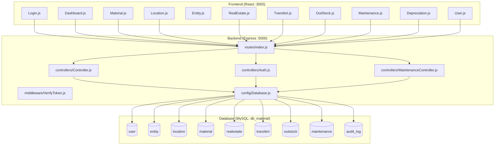

# Hotel Asset Management System

[](https://github.com/yourusername/hotel-asset/actions)
[](https://opensource.org/licenses/MIT)
[](https://nodejs.org)
[](https://reactjs.org)

A full-stack web application designed for hotels and resorts to track physical assets, furniture, electronics, and inventory across entities (buildings, complexes) and locations (rooms, suites, restaurants, storage).

## Features

### Core Asset Management
- **Entity Management**: Track hotel complexes, wings, and pavilions
- **Location Management**: Manage rooms, suites, departments, and storage areas
- **Material Catalog**: Comprehensive asset catalog with pricing, images, and categorization
- **Inventory Allocation**: Real-time asset allocation per room/location
- **Asset Transfers**: Track asset movements between locations with full audit trail
- **Decommissioning**: Log damaged, retired, or written-off assets

### Advanced Features
- **Maintenance Tracking**: Schedule preventive and corrective maintenance, track repair costs and technician assignments
- **Depreciation Calculator**: Straight-line depreciation with useful life, salvage value, and current book value
- **QR Code Asset Tagging**: Generate printable QR codes for rooms and equipment
- **Analytics Dashboard**: Interactive charts for asset distribution, depreciation breakdown, and transfer velocity
- **PDF & CSV Export**: Export room inventories and transfer slips
- **Audit Trail**: Complete audit log for inventory movements and write-offs

### Security
- JWT-based authentication with refresh tokens
- Protected API routes for all state-altering operations
- Role-based access control (Admin/User)
- Secure password hashing with bcrypt

## Architecture



## Tech Stack

- **Frontend**: React 18, React Router v6, Axios, Bootstrap, JWT Decode, Chart.js
- **Backend**: Node.js, Express (ES modules), Sequelize ORM, JWT, BcryptJS, MySQL2
- **Database**: MySQL 8.0+ (`db_material`)

## Prerequisites

- Node.js 18 or higher
- MySQL 8.0 or higher
- npm or yarn

## Installation

### 1. Clone the Repository

```bash
git clone https://github.com/yourusername/hotel-asset.git
cd hotel-asset
```

### 2. Database Setup

```bash
# Create database and schema
mysql -u root -p < database/schema.sql

# Load seed data (required for the documented default login)
mysql -u root -p db_material < database/seed.sql
```

### 3. Backend Setup

```bash
cd nodejs
npm install

# Create environment file
cp .env.example .env

# Edit .env with your database credentials
# Default admin credentials: admin / admin123
```

If `admin / admin123` is rejected, import `database/seed.sql` again to reset the
seed users' passwords, then restart the backend.

**`.env` Configuration:**
```env
PORT=5000
DB_HOST=localhost
DB_PORT=3306
DB_NAME=db_material
DB_USER=root
DB_PASS=your_password
ACCESS_TOKEN_SECRET=your_access_secret
REFRESH_TOKEN_SECRET=your_refresh_secret
```

Start the backend server:
```bash
npm start
```

### 4. Frontend Setup

```bash
cd reactjs
npm install
npm start
```

The application will be available at `http://localhost:3000`

## API Reference

### Authentication

| Endpoint | Method | Description | Auth Required |
|----------|--------|-------------|---------------|
| `/api/auth/login` | POST | User login | No |
| `/api/auth/refresh` | POST | Refresh access token | No |
| `/api/auth/logout` | POST | User logout | Yes |

### Entities (Buildings)

| Endpoint | Method | Description | Auth Required |
|----------|--------|-------------|---------------|
| `/api/entity` | GET | Get all entities | Yes |
| `/api/entity` | POST | Create new entity | Yes |
| `/api/entity/:id` | PUT | Update entity | Yes |
| `/api/entity/:id` | DELETE | Delete entity | Yes |

### Locations (Rooms)

| Endpoint | Method | Description | Auth Required |
|----------|--------|-------------|---------------|
| `/api/location` | GET | Get all locations | Yes |
| `/api/location` | POST | Create new location | Yes |
| `/api/location/:id` | PUT | Update location | Yes |
| `/api/location/:id` | DELETE | Delete location | Yes |

### Materials (Assets)

| Endpoint | Method | Description | Auth Required |
|----------|--------|-------------|---------------|
| `/api/material` | GET | Get all materials | Yes |
| `/api/material` | POST | Create new material | Yes |
| `/api/material/:id` | PUT | Update material | Yes |
| `/api/material/:id` | DELETE | Delete material | Yes |

### Inventory (RealEstate)

| Endpoint | Method | Description | Auth Required |
|----------|--------|-------------|---------------|
| `/api/realestate` | GET | Get inventory allocations | Yes |
| `/api/realestate` | POST | Allocate asset to location | Yes |
| `/api/realestate` | PUT | Update allocation quantity | Yes |
| `/api/realestate` | DELETE | Remove allocation | Yes |

### Transfers

| Endpoint | Method | Description | Auth Required |
|----------|--------|-------------|---------------|
| `/api/transfert` | GET | Get transfer history | Yes |
| `/api/transfert` | POST | Create asset transfer | Yes |

### Decommissioning (OutStock)

| Endpoint | Method | Description | Auth Required |
|----------|--------|-------------|---------------|
| `/api/outstock` | GET | Get decommissioned assets | Yes |
| `/api/outstock` | POST | Decommission asset | Yes |

### Maintenance

| Endpoint | Method | Description | Auth Required |
|----------|--------|-------------|---------------|
| `/api/maintenance` | GET | Get maintenance records | Yes |
| `/api/maintenance` | POST | Create maintenance record | Yes |
| `/api/maintenance/:id` | PUT | Update maintenance record | Yes |
| `/api/maintenance/:id` | DELETE | Delete maintenance record | Yes |

### Analytics

| Endpoint | Method | Description | Auth Required |
|----------|--------|-------------|---------------|
| `/api/dashboard/stats` | GET | Get dashboard metrics | Yes |
| `/api/depreciation/report` | GET | Get depreciation report | Yes |

## Default Credentials

- **Username**: `admin`
- **Password**: `admin123`

⚠️ **Important**: Change the default admin password after first login in production.

## Screenshots

*[Add screenshots of the dashboard, asset management, and analytics pages]*

## Development

### Running Tests

```bash
# Backend tests
cd nodejs
npm test

# Frontend tests
cd reactjs
npm test
```

### Building for Production

```bash
# Build React app
cd reactjs
npm run build

# The build output will be in reactjs/build/
```

## Contributing

Contributions are welcome! Please read [CONTRIBUTING.md](CONTRIBUTING.md) for details on our code of conduct and the process for submitting pull requests.

## License

This project is licensed under the MIT License - see the [LICENSE](LICENSE) file for details.

## Security

For security vulnerabilities, please see [SECURITY.md](SECURITY.md) for reporting guidelines.

## Changelog

See [CHANGELOG.md](CHANGELOG.md) for a history of changes.

## Support

For support, email support@yourdomain.com or open an issue on GitHub.

## Acknowledgments

- Built with React and Express
- Database managed with Sequelize ORM
- Authentication using JWT
