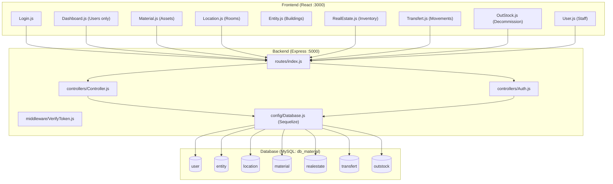

# Hotel Asset Management Web App — Comprehensive Modernization Plan

## Goal Description

**Hotel Asset Management** is a full-stack web application designed for hotels and resorts to track physical assets, furniture, electronics, and inventory across entities (buildings, complexes) and locations (rooms, suites, restaurants, storage).

The tech stack consists of:
- **Frontend**: React 18, React Router v6, Axios, Bootstrap, JWT Decode
- **Backend**: Node.js, Express (ES modules), Sequelize ORM, JWT, BcryptJS, MySQL2
- **Database**: MySQL (`db_material`)

Following your request to **"Do the same thing"** as for the previous university project, this plan addresses three core pillars:
1. **Database Setup**: Reverse-engineer and deliver complete MySQL database schema and seed data (`database/schema.sql` and `database/seed.sql`) so anyone can bootstrap the database from scratch.
2. **Advanced Modern Features**: Architecture overhaul (proper HTTP responses, route security, error handling), plus high-value hotel asset capabilities:
   - **Asset Maintenance & Inspection Tracking** (scheduled repairs, warranty dates, status, cost)
   - **Asset Depreciation & Valuation Calculator** (straight-line depreciation, useful life, current book value)
   - **QR Code Asset Tagging** for rooms and equipment
   - **Modern Analytics Dashboard** with interactive charts (Asset allocation by room, depreciation breakdown, transfer velocity)
   - **PDF & CSV Export** for room inventories and transfer slips
   - **Audit Trail** for inventory movements and write-offs
3. **GitHub Suite**: Complete Git repository setup, GitHub Actions CI/CD workflows, issue templates, PR template, Dependabot, and professional documentation.

---

## Current Architecture & State



### Critical Findings & Deficiencies

| Category | Issue | Impact |
|---|---|---|
| **Database** | No SQL schema or seed file exists | Impossible to recreate or deploy DB on new machines |
| **API Response** | Controllers (`entInsert`, `locInsert`, `matInsert`, etc.) do not send HTTP responses (`res.json()`) | Requests hang until browser timeout or client receives no confirmation |
| **Security** | Only `userSelect` has `verifyToken`; all other CRUD routes are unauthenticated | Anyone can insert, update, or delete hotel assets without login |
| **Asset Images** | `MatImg` is defined as `DataTypes.BLOB` stored in MySQL | Large payload size, memory leaks, slow table scans |
| **Git & Repo** | No Git repository initialized, no root `.gitignore`, no documentation | No version control or CI/CD pipelines |
| **Dashboard** | Dashboard only displays user table, not asset stats | Zero operational insights for hotel managers |
| **Features** | Missing maintenance tracking, depreciation, barcode/QR tags, and inventory exports | Crucial hotel asset lifecycle operations cannot be performed |

---

## User Review Required

> [!IMPORTANT]
> **Database Name**: The application connects to `db_material`. The schema will generate this database if it does not exist. Please confirm whether you prefer keeping `db_material` or renaming it to `db_hotel_asset`. (By default, we keep `db_material` for 100% backward compatibility).

> [!WARNING]
> **JWT Route Protection**: All API endpoints (locations, materials, transfers, etc.) will be secured behind `verifyToken`. If you have external scripts calling these endpoints without tokens, they will need the `Authorization: Bearer <token>` header.

---

## Open Questions

> [!NOTE]
> 1. **Default Admin Credentials**: For the seed data, should we initialize `admin` with password `admin123`?
> 2. **Asset Photos Storage**: Should asset images be stored on disk in `nodejs/uploads/` with public static URL paths, or keep base64/blob compatibility? (Recommended: local disk upload with public static route).

---

## Proposed Changes

---

### Phase 1: Database Setup (`database/`)

#### [NEW] database/schema.sql
Creates the complete schema for `db_material` with primary keys, foreign keys, cascade rules, and indexes. Also adds tables for maintenance and audit logs.

```sql
CREATE DATABASE IF NOT EXISTS `db_material`
  CHARACTER SET utf8mb4 COLLATE utf8mb4_unicode_ci;
USE `db_material`;

-- 1. Entity (Buildings / Hotel Pavilions)
CREATE TABLE `entity` (
  `EntID` INT AUTO_INCREMENT PRIMARY KEY,
  `EntName` VARCHAR(50) NOT NULL
) ENGINE=InnoDB;

-- 2. Location (Rooms, Suites, Departments)
CREATE TABLE `location` (
  `LocID` INT AUTO_INCREMENT PRIMARY KEY,
  `LocName` VARCHAR(50) NOT NULL,
  `LocColor` VARCHAR(7) DEFAULT '#4e73df',
  `EntID` INT,
  FOREIGN KEY (`EntID`) REFERENCES `entity`(`EntID`) ON DELETE SET NULL
) ENGINE=InnoDB;

-- 3. Material (Hotel Assets / Catalog)
CREATE TABLE `material` (
  `MatID` INT AUTO_INCREMENT PRIMARY KEY,
  `MatName` VARCHAR(100) NOT NULL,
  `MatPrice` DECIMAL(12, 2) NOT NULL DEFAULT 0.00,
  `MatDate` DATE,
  `MatImg` VARCHAR(255) NULL,
  `UsefulLifeYears` INT DEFAULT 5,
  `SalvageValue` DECIMAL(12, 2) DEFAULT 0.00
) ENGINE=InnoDB;

-- 4. RealEstate (Room Asset Inventory / Allocation)
CREATE TABLE `realestate` (
  `MatID` INT NOT NULL,
  `LocID` INT NOT NULL,
  `ResQty` INT NOT NULL DEFAULT 1,
  PRIMARY KEY (`MatID`, `LocID`),
  FOREIGN KEY (`MatID`) REFERENCES `material`(`MatID`) ON DELETE CASCADE,
  FOREIGN KEY (`LocID`) REFERENCES `location`(`LocID`) ON DELETE CASCADE
) ENGINE=InnoDB;

-- 5. User (Hotel Staff / Admins)
CREATE TABLE `user` (
  `UserID` INT AUTO_INCREMENT PRIMARY KEY,
  `UserName` VARCHAR(50) NOT NULL UNIQUE,
  `UserPword` VARCHAR(255) NOT NULL,
  `UserType` VARCHAR(20) NOT NULL DEFAULT 'User',
  `refresh_token` TEXT NULL
) ENGINE=InnoDB;

-- 6. Transfert (Asset Movements Between Rooms)
CREATE TABLE `transfert` (
  `TransID` INT AUTO_INCREMENT PRIMARY KEY,
  `TransDate` DATETIME DEFAULT CURRENT_TIMESTAMP,
  `TransQty` INT NOT NULL,
  `MatID` INT NOT NULL,
  `LocSend` INT NOT NULL,
  `LocRecip` INT NOT NULL,
  `UserID` INT,
  FOREIGN KEY (`MatID`) REFERENCES `material`(`MatID`),
  FOREIGN KEY (`LocSend`) REFERENCES `location`(`LocID`),
  FOREIGN KEY (`LocRecip`) REFERENCES `location`(`LocID`),
  FOREIGN KEY (`UserID`) REFERENCES `user`(`UserID`)
) ENGINE=InnoDB;

-- 7. OutStock (Decommissioning / Damaged / Write-offs)
CREATE TABLE `outstock` (
  `OutID` INT AUTO_INCREMENT PRIMARY KEY,
  `OutDate` DATETIME DEFAULT CURRENT_TIMESTAMP,
  `OutQty` INT NOT NULL,
  `OutMotiv` VARCHAR(100) NOT NULL,
  `MatID` INT NOT NULL,
  `LocID` INT NOT NULL,
  `UserID` INT,
  FOREIGN KEY (`MatID`) REFERENCES `material`(`MatID`),
  FOREIGN KEY (`LocID`) REFERENCES `location`(`LocID`),
  FOREIGN KEY (`UserID`) REFERENCES `user`(`UserID`)
) ENGINE=InnoDB;

-- 8. Maintenance [NEW ADVANCED TABLE]
CREATE TABLE `maintenance` (
  `MaintID` INT AUTO_INCREMENT PRIMARY KEY,
  `MatID` INT NOT NULL,
  `LocID` INT NOT NULL,
  `MaintType` ENUM('Preventive', 'Corrective', 'Inspection') NOT NULL DEFAULT 'Corrective',
  `MaintDesc` TEXT NOT NULL,
  `MaintCost` DECIMAL(10, 2) DEFAULT 0.00,
  `MaintStatus` ENUM('Scheduled', 'In Progress', 'Completed') DEFAULT 'Scheduled',
  `ScheduledDate` DATE NOT NULL,
  `CompletedDate` DATE NULL,
  `Technician` VARCHAR(100) NULL,
  `UserID` INT,
  FOREIGN KEY (`MatID`) REFERENCES `material`(`MatID`),
  FOREIGN KEY (`LocID`) REFERENCES `location`(`LocID`),
  FOREIGN KEY (`UserID`) REFERENCES `user`(`UserID`)
) ENGINE=InnoDB;
```

#### [NEW] database/seed.sql
Contains realistic hotel seed data:
- Hotel Entities: `Main Hotel Palace`, `Beach Villas`, `Spa & Wellness Pavilion`, `Grand Restaurant`
- Rooms/Locations: `Suite Presidential 501`, `Deluxe Room 201`, `Executive Suite 305`, `Master Kitchen`, `Conference Hall`
- Materials: `Smart TV Samsung 65" 4K`, `Queen Size Bed & Mattress`, `Minibar Dometic 40L`, `Safe Electronic Yale`, `Espresso Machine Nespresso`, `Ergonomic Office Chair`
- Pre-allocated room inventory, sample transfer logs, sample out-of-stock logs, and initial admin accounts.

---

### Phase 2: Advanced Backend & Security Modernization (`nodejs/`)

#### [MODIFY] nodejs/controllers/Controller.js
- Fix all CRUD endpoints to return standard JSON responses with status codes (`res.status(200).json(...)`, `res.status(201).json(...)`, `res.status(400).json(...)`, `res.status(500).json(...)`).
- Add Maintenance CRUD controllers (`maintSelect`, `maintInsert`, `maintUpdate`, `maintDelete`).
- Add Asset Depreciation Calculator controller (`depreciationReport`): computes straight-line depreciation per asset and total hotel net book value.
- Add Dashboard Metrics controller (`dashboardStats`): computes counts, values, low-stock warnings, and recent activity in a single optimized endpoint.

#### [MODIFY] nodejs/routes/index.js
- Protect state-altering routes with `verifyToken`.
- Add routes for Maintenance, Depreciation, Dashboard analytics, and Inventory export.

#### [MODIFY] nodejs/config/Database.js
- Enhance database connection to support environment variables (`DB_HOST`, `DB_PORT`, `DB_NAME`, `DB_USER`, `DB_PASS`) with fallback to local defaults.

#### [NEW] nodejs/.env.example
- Template for all environment variables (Access token, Refresh token, Port, DB settings).

---

### Phase 3: Advanced Frontend Modernization (`reactjs/`)

#### [MODIFY] reactjs/src/components/Dashboard.js
Transform the bare user table into a comprehensive Hotel Asset Command Center:
- **Metrics KPI Cards**: Total Asset Value ($), Total Units in Rooms, Active Locations/Rooms, Maintenance In Progress.
- **Interactive Visualizations (Chart.js / Recharts)**:
  - Asset Distribution by Hotel Entity & Location.
  - Asset Net Book Value vs Original Cost (Depreciation).
  - Recent transfers and inventory movements.
- **Quick Action Bar**: Fast asset transfer, report maintenance, new asset registration.

#### [NEW] reactjs/src/components/Maintenance.js
- Full maintenance management dashboard: schedule inspections, log technician repairs, track maintenance expenses, update status from 'Scheduled' to 'Completed'.

#### [NEW] reactjs/src/components/Depreciation.js
- Asset financial depreciation report calculating:
  - Useful life, annual depreciation rate, accumulated depreciation, and current book value.
  - Export to CSV / Print report.

#### [MODIFY] reactjs/src/components/Navbar.js
- Add navigation links for `Maintenance`, `Depreciation`, and `Dashboard`.
- Add user badge and active role indication.

#### [MODIFY] reactjs/src/components/Material.js & Location.js
- Add QR code generation component (`react-qr-code` or SVG generator) for every asset and room tag.
- Print asset tag badges with QR code, Room number, and Asset ID.
- Add CSV export for room inventories.

---

### Phase 4: Full GitHub Ecosystem Setup

#### [NEW] .gitignore (Root)
Ignores `node_modules/`, `.env`, build artifacts, and system files across both `nodejs` and `reactjs`.

#### [NEW] .github/workflows/ci.yml
Automated GitHub Actions workflow:
- **Backend Job**: Setup Node.js 18 & 20, install backend dependencies, test server start.
- **Frontend Job**: Setup Node.js, install dependencies, run `npm run build` to verify React compilation.
- **Database Job**: Spin up MySQL 8.0 service container, validate `database/schema.sql` and `database/seed.sql`.

#### [NEW] .github/workflows/deploy.yml
Automated Docker / Production packaging workflow.

#### [NEW] Community Files
- `README.md`: High-quality README with badges, screenshots, architecture diagram, installation commands, API reference.
- `CONTRIBUTING.md`: Contribution guide and Git branching workflow.
- `CODE_OF_CONDUCT.md`: Contributor Covenant v2.1.
- `LICENSE`: MIT License.
- `SECURITY.md`: Vulnerability reporting process.
- `CHANGELOG.md`: Versioning log.
- `.github/ISSUE_TEMPLATE/bug_report.yml` & `feature_request.yml`.
- `.github/pull_request_template.md`.
- `.github/dependabot.yml`.

---

## File Change Summary

| Component | Files | Action |
|---|---|---|
| **Database** | `database/schema.sql`, `database/seed.sql` | **NEW** |
| **Backend** | `nodejs/config/Database.js` | **MODIFY** |
| **Backend** | `nodejs/controllers/Controller.js` | **MODIFY** |
| **Backend** | `nodejs/controllers/MaintenanceController.js` | **NEW** |
| **Backend** | `nodejs/models/MaintenanceModel.js` | **NEW** |
| **Backend** | `nodejs/routes/index.js` | **MODIFY** |
| **Backend** | `nodejs/index.js` | **MODIFY** |
| **Backend** | `nodejs/.env.example` | **NEW** |
| **Frontend** | `reactjs/src/App.js` | **MODIFY** |
| **Frontend** | `reactjs/src/components/Navbar.js` | **MODIFY** |
| **Frontend** | `reactjs/src/components/Dashboard.js` | **MODIFY** |
| **Frontend** | `reactjs/src/components/Maintenance.js` | **NEW** |
| **Frontend** | `reactjs/src/components/Depreciation.js` | **NEW** |
| **Frontend** | `reactjs/src/components/Material.js` | **MODIFY** |
| **GitHub** | `.gitignore`, `.gitattributes`, `README.md`, `CONTRIBUTING.md`, `LICENSE`, `SECURITY.md`, `CHANGELOG.md`, `CODE_OF_CONDUCT.md` | **NEW** |
| **GitHub** | `.github/workflows/ci.yml`, `deploy.yml`, `dependabot.yml`, `FUNDING.yml`, templates | **NEW** |

---

## Verification Plan

### Automated Verification
1. **Database Schema Validation**: Run schema and seed script against MySQL or parse SQL syntax.
2. **Backend API Validation**: Ensure Express starts without syntax errors, models load successfully with Sequelize.
3. **Frontend Compilation**: Run React build (`npm run build`) in `reactjs/` to verify zero compile errors or broken imports.
4. **Git Verification**: Validate git commit, history, and status.

### Manual Verification
1. **Authentication Flow**: Login as admin, verify JWT token generation, refresh token, and logout.
2. **Asset Lifecycle**: Add an asset, assign it to a hotel room (`realestate`), transfer it to another room (`transfert`), and decommission a damaged unit (`outstock`).
3. **Maintenance Tracking**: Schedule repair on an asset, update status to completed, verify cost calculation.
4. **Depreciation**: View the depreciation schedule and check book value computation.
5. **Print & QR Codes**: Test QR code display and printable inventory sheets.
